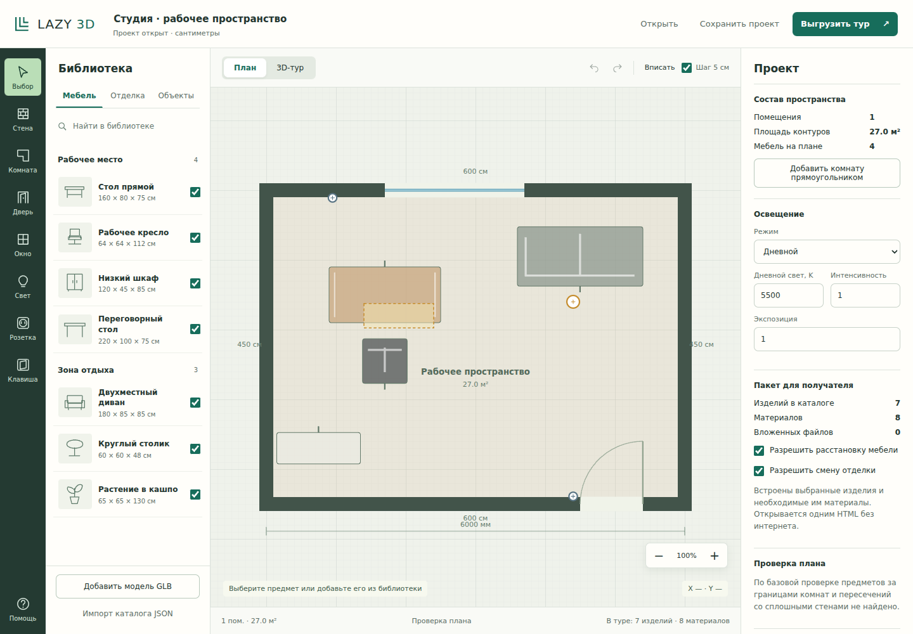

# Lazy 3D Tour Planer

Редактор планировок и конструктор автономных 3D-туров. Автор задаёт помещение, отделку, оборудование и доступные каталоги. Получатель открывает один HTML-файл и расставляет мебель из переданного набора.

Первая рабочая версия: один этаж, прямые стены произвольного направления и полигональные помещения. Координаты хранятся в сантиметрах.



## Запуск

Нужен Node.js 20 или новее. Для самого приложения устанавливать зависимости не требуется.

```bash
git clone https://github.com/sakrett001-ai/Lazy-3d-tour-planer.git
cd Lazy-3d-tour-planer
npm start
```

Откройте **http://127.0.0.1:4173**. Сервер работает локально. Проект сохраняется в браузере; кнопка «Сохранить проект» скачивает JSON для дальнейшей работы.

## Что работает

- 2D-план и интерактивный 3D-тур на общем формате данных.
- Стены, прямоугольные и полигональные комнаты; точные координаты, толщина и высота стен.
- Двери и окна: положение, ширина, высота, подоконник, петли и сторона открывания. Проверяется выход за стену и перекрытие проёмов.
- Расстановка, перенос, поворот и высота мебели; отмена и повтор действий.
- Светильники, розетки и выключатели с координатами и высотой. У источников света задаются температура и интенсивность.
- Штукатурка, кирпич, древесина, рогожка, кожа и рейки. Физический масштаб, шероховатость, рельеф; загрузка color, normal и roughness-карт. Рейки имеют объёмную геометрию с вырезами вокруг проёмов.
- Импорт статической GLB-мебели и JSON-каталогов; размеры GLB читаются из геометрии.
- Выбор состава каталога и прав получателя. Экспорт включает выбранные и уже расставленные изделия, используемые материалы и необходимые файлы.
- Автономный HTML: каталог, 2D-расстановка, 3D-прогулка и сохранение варианта без интернета.

Семь встроенных изделий — нейтральные процедурные образцы. Файлы, оформление и каталоги заказчиков в репозиторий не перенесены.

## Как работать

1. Выберите изделие слева и нажмите на план. Перетаскивайте его или задавайте координаты справа.
2. «Стена» принимает две точки. «Комната» — вершины и Enter. Двери, окна и розетки ставятся нажатием на стену.
3. Выберите стену или пол, затем отделку. Материал без выбранной поверхности открывает свои настройки.
4. Галочки рядом с изделиями определяют пакет. Чтобы исключить уже расставленное изделие, сначала удалите его экземпляры.
5. «Выгрузить тур» создаёт HTML. Получатель открывает «План», меняет разрешённую расстановку и сохраняет JSON варианта.

Колесо мыши меняет масштаб; пробел с перетаскиванием перемещает план. Escape отменяет построение, Delete удаляет объект, Ctrl+Z отменяет действие. На узком экране библиотека и свойства открываются нижними кнопками.

## Сборка и проверки

```bash
npm test
npm run build
```

Сборка создаёт `out/lazy-demo-tour.html` с автономным конструктором расстановки и `out/scene.html` только с визуализатором.

Браузерные проверки требуют Playwright и Chromium:

```bash
npm install
npx playwright install chromium
npm run test:browser
```

Для установленного Chromium задайте `CHROMIUM_EXECUTABLE`. Снимки и отчёты появляются в `test-results/`. CPU-проверка геометрии и браузерная проверка WebGL — отдельные этапы.

## Устройство

| Путь | Назначение |
| --- | --- |
| `app/` | Интерфейс автора и автономного получателя |
| `src/project.mjs` | Контракт, проверки, операции, состав пакета |
| `src/compile.mjs` | Адаптация в движок и сборка HTML |
| `src/glb.mjs` | Проверка GLB и измерение геометрии |
| `engine/runtime/` | Перенесённый движок Three.js и новый адаптер |
| `engine/tools/` | Экспорт геометрии, проверки, отдельный Blender/Cycles-конвейер |
| `examples/` | Нейтральная планировка и шаблон каталога |

Подробнее: [формат](docs/project-format.md), [архитектура](docs/architecture.md), [проверки](docs/verification.md), [развитие](docs/roadmap.md).

## Границы версии

Это рабочая основа конструктора. Пока нет этажей, лестниц, криволинейных стен, автоматической увязки пола со стенами, расчёта освещённости и облачной библиотеки производителей. Стены и контуры пола редактируются отдельно; проверка коллизий приблизительная.

GLB должен содержать статическую геометрию и упакованные текстуры, без обязательных внешних декодеров, Draco/Meshopt и скелета. Максимум одного GLB — 30 МБ, вложенных файлов — 50 МБ. Поддерживается до 16 источников света; динамические тени получают первые четыре и солнце. Эти пределы не гарантируют скорость большого проекта на телефоне.

Ограничения получателя реализованы в интерфейсе и контракте. Открытый HTML не является DRM: в него нужно включать только разрешённые к передаче файлы.

## Лицензия

Сохранена [Apache-2.0](LICENSE). Three.js и его GLTF-модули сохраняют [MIT-лицензию](licenses/threejs-MIT.txt). Происхождение компонентов: [NOTICE](NOTICE).
